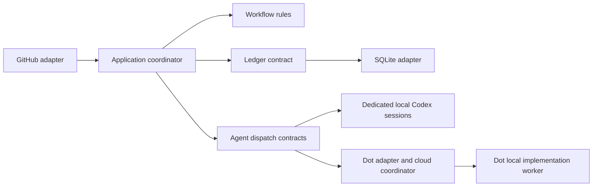

# Lighthouse Architecture Proposal

This is a review proposal under [Craig Architecture](standards/Craig-Architecture.md).
The [Open Questions register](../decisions/open-questions.md) controls unresolved
choices. Only decisions explicitly recorded as approved have been adopted.

## Product boundary and first outcome

Lighthouse automates authorized development handoffs between independent agents,
using GitHub as the shared coordination record. Craig keeps consequential decision
and merge authority. Koios Cold is the first configured project; its rules,
repository, workspaces, and verification commands belong to its profile.

The first complete demonstration follows one authorized Issue through Dot's PR,
Codex review, a revision on that PR, Craig's actual merge, and release of the next
eligible Issue. A second synthetic project profile proves isolation without a
core-code change. Publishing a notification alone does not satisfy this outcome.

## Proposed technical baseline

Use one headless Python process, TOML configuration, and a local SQLite ledger.
Start with explicit manual composition and a command-line operator surface.
Use one authoritative ledger for this deployment; coordination across independent
ledger files or multiple hosts is outside the initial scope.
Use the existing Python 3.14 environment for feasibility work; establish the
supported runtime and pinned dependency set in T00. No source packages or
runtime configuration are created by this proposal.

SQLite supplies transactional local persistence; atomically committing a claim,
transition, audit entry, and pending dispatch is a design requirement, to be
tested in T05. SQLite does not make an external agent launch atomic with that
transaction. [SQLite transactional guarantees](https://www.sqlite.org/transactional.html).

## Responsibility ownership

| Area | Owns | Boundary |
| --- | --- | --- |
| Domain | Eligibility, dependencies, allowed transitions, role checks, review freshness, active-work invariants | Pure decisions over normalized facts and explicit time inputs; no SDK, SQL, HTTP, or TOML imports |
| Application | Reconciliation, transactional claims, dispatch sequencing, receipt processing, recovery and operator queries | Calls inward-owned contracts; makes no provider-specific eligibility rules |
| Adapters | GitHub translation, SQLite transactions, Codex sessions, Dot delivery and receipts, secret resolution | Implement narrow contracts and translate failures into application vocabulary |
| Composition and CLI | Load validated configuration, select adapters, wire dependencies, start/stop and show status | Outer entry points; imports do not launch services or open connections |

Runtime calls follow this shape; source dependencies point inward:



## Authoritative state

| Information | Authority | Lighthouse treatment |
| --- | --- | --- |
| Issue content, labels and their actors; PR author, base, head, reviews and merge | GitHub | Keep attributed observations and refresh decision-critical facts before action |
| Accepted work-order snapshot, project reservation, phase, dispatch IDs, receipts and transition history | SQLite ledger | Canonical internal execution state; never fabricate a GitHub approval or merge |
| Roles, repository identity, branches, paths, label mapping, verification requirements and limits | Validated project profile | Store a profile fingerprint with accepted work; changed authority or scope requires reconciliation |
| Logs, status displays and workflow labels/comments | Derived operational views | Rebuild or reconcile from the authorities above; a label is not proof of review or merge |

Provider observations are not a competing copy of repository truth. The ledger
records why Lighthouse acted on particular observed revisions. An agent's
completion receipt is execution evidence; GitHub must confirm its claimed PR or review.

## Workflow and admission

Proposed admission requires an open Issue, a ready label applied by the configured
Lead or Craig, no blocked marker, complete dependencies, a captured scope and
verification contract, and a free project reservation. Never infer authorization
from arbitrary Issue text. Rank ready work deterministically using configured
priority labels, then creation time and Issue number.

For managed dependencies, completion means a verified merged run. An unmanaged
dependency needs an explicit Lead/Owner resolution before admission. Captured
scope changes require renewed authorization before another dispatch. These
conventions are proposals requiring the RQ-03 decision.

| Phase | Entry evidence | Next permitted action |
| --- | --- | --- |
| Ready candidate | Admission facts above | Atomically reserve the project and create an implementation dispatch |
| Implementation queued | Durable work order and dispatch ID | Send the same ID through Dot's adapter |
| Implementing | Attributed acceptance and external run identity | Observe the existing run and its PR; retain reservation |
| Review queued | Linked, non-draft PR by the configured implementer, in the expected repository and integration branch | Capture its current head and dispatch Codex |
| Reviewing | Lead session receipt for that head | Observe GitHub's attributed review outcome |
| Revision queued | Latest relevant Lead review requests changes | Dispatch Dot against the same Issue and PR |
| Awaiting owner merge | Current head has valid Lead approval and required verification evidence | Notify Craig once and continue observing; there is no merge operation |
| Completed | GitHub confirms the expected PR was actually merged by Craig, review/verification evidence covers the merged head, and old executions are quiescent | Record completion and release the project reservation |

An approval applies only to its reviewed commit. A new head supersedes an older
approval and review request. Coalesce head updates while an older review stops;
do not launch overlapping reviews for obsolete heads. A comment-only review,
stale/dismissed approval, or another actor's approval cannot satisfy the Lead gate.
Record the reviewed PR head separately from GitHub's resulting merge commit;
these hashes need not match. Completion requires review evidence for the PR head
that was merged, submitted before the merge occurred. A populated test-merge SHA
does not establish that a PR merged. [PR merge metadata](https://docs.github.com/en/rest/pulls/pulls#get-a-pull-request).

Closing a PR without merge, closing an Issue alone, or observing a merge by an
unexpected actor requires attention. Hold the reservation pending reconciliation.
Do not release it merely because a lease or timeout expired.

## Duplicate handling and failure recovery

1. Give normalized observations stable provider/revision keys. Repeated or
   reordered observations cannot create another transition or active work item.
2. In one explicit ledger transaction, check expected versions, reserve the
   project, record the transition and audit evidence, and enqueue a stable
   dispatch ID. Enforce one active work item per project with a database constraint.
3. Send external work after commit. Submission returns an acceptance/status handle;
   long agent work cannot block reconciliation or the other adapter endpoints.
   Persist acceptance, external run identity and outcome separately. Receiver
   claims must recognize the same dispatch ID.
4. Retry transport delivery only where the receiver can recognize that ID.
   Reconcile a lost acknowledgement through the existing run identity or claim.
   If acceptance cannot be established, hold the work and request intervention.
5. On restart, reconcile incomplete dispatches and fresh GitHub state before
   admitting work. Competing coordinator processes using that ledger must not
   obtain two claims.

Exactly-once external effects require receiver support. The integration proofs
must establish duplicate handling or demonstrate a safe attention hold. Neither
an HTTP success response nor an expired lease proves that an agent did or did not run.

Failures retain their work identity, cause, last confirmed state, and next owner.
Retryable network errors have bounded backoff. Permission failures, ambiguous
launches, changed scope, corrupted state, and approval requests become visible
attention states. A worker becoming unavailable never silently abandons its task.

## GitHub observation and identity

Propose a configurable 60-second reconciliation interval, conditional requests,
serialized API calls, complete pagination, and rate-limit-aware backoff. Refresh
active PR heads and review/merge facts before consequential decisions. Startup
and periodic complete reconciliation supplement overlapping incremental scans.
Persist a cache body with its validator before relying on an unchanged response;
an incomplete page or failed request cannot become an empty authoritative result.

GitHub recommends webhooks, with efficient conditional polling when webhooks are
unavailable. Local polling avoids adding public ingress for the first deployment.
[GitHub REST practices](https://docs.github.com/en/rest/using-the-rest-api/best-practices-for-using-the-rest-api).
The activity feed is an optional hint, with limitations recorded in the
[integration assessment](integration-assessment.md).

| Action | Identity and credential boundary |
| --- | --- |
| Poll repository state | Read-only, repository-scoped Codex App token |
| Publish derived workflow metadata | Narrow Codex App writer; it cannot grant readiness, submit reviews, or merge through its application contract |
| Implement, push and create/update a PR | Dot App in Dot's own context and checkout |
| Review and submit findings | Codex App in the dedicated Lead review context; distinct from the implementer |
| Merge and release | Craig outside the engine; no owner credentials or merge/tag capability in orchestration ports |

Use configured numeric actor identities, validated against provider data. Each
adapter receives only its required credentials; do not hand Dot's key to Codex
review sessions or route ordinary runtime work through Craig's personal login.
The existing broad App registrations are not an excuse for broad runtime tokens.

GitHub's current basic protections do not themselves enforce the named Lead
reviewer or Craig-only merging. Lighthouse must detect violations and hold work;
this proposal does not claim a security boundary against an administrator or an
independently misused App credential.

## Project profiles and candidate layout

Separate shared service settings from per-project TOML profiles. A profile
identifies the source-control adapter and repository, integration/release
branches, Owner/Lead/implementer identities, separate workspace references,
credential references, label mapping, dependency/priority conventions, and
verification requirements. Store real paths and credential bindings locally.
Committed examples use synthetic values and cannot activate a live project.

Reject unsupported fields or policies explicitly. The first implementation
supports one active work item per project and mandatory independent review and
human merge. A profile cannot turn those safeguards off. Adding another supported
project should require configuration and its instructions, without changing the core.

Candidate source homes, created only when a task needs them:

```text
src/lighthouse/
  domain/                 workflow facts, policies and transitions
  application/            coordination use cases and consuming contracts
  adapters/               github, sqlite, codex and dot implementations
  configuration/          TOML loading and boundary validation
  cli.py                  operator commands
  bootstrap.py            explicit composition
tests/                    domain, application, adapter and controlled integration checks
profiles/examples/        inactive synthetic project examples
config/examples/          inactive service examples
```

Keep contracts focused on actual consumers. Use cohesive modules and informative
docstrings; split by responsibility as the implementation earns boundaries. No
generic helper collection, container framework, broker, server database, Docker
deployment, or web frontend is proposed.

## Operator experience and rollout

Start and stop a local foreground headless process explicitly. Provide profile
validation and read-only status showing project, Issue/PR, phase, head, active
dispatch, last observation, failure/approval hold, and next actor. JSON logs carry
correlation IDs and bounded summaries; the ledger owns transition history.
Credentials and callback secrets stay outside tracked files, audit payloads,
logs, fixtures and prompts. Store secret references rather than secret values.

Notify on meaningful transitions, approval needs, or failures; suppress unchanged
poll noise. Operator recovery must recheck authority and external state, without
commands that manufacture approvals, merges, or completion. Windows autostart,
additional concurrency and an optional dashboard are later decisions.

The [initial plan](../development/initial-plan.md) front-loads integration proofs
and keeps live activation behind explicit gates.
