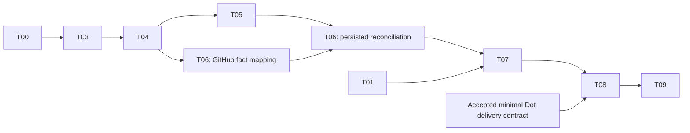

# Lighthouse Initial Development Plan

Craig approved this T00–T09 plan and its bounded delegation on 2026-11-23. These
task contracts are the basis for future Issues, not evidence of published Issues
or active assignments. Follow the [system architecture](../architecture/proposal.md),
[integration assessment](../architecture/integration-assessment.md), and
[decision register](../decisions/open-questions.md). Craig's explicit adoption
grants plan authority; implementation starts after the planning PR merges into
`development` and follows each task's readiness and execution gates.

Craig approved the Python/TOML/SQLite baseline in RQ-02, the admission policy
in RQ-03, the feasibility-first T00–T02 stage in RQ-04 and the rollout policy
in RQ-05. The [work intake contract](work-intake.md) records delegated label and field
conventions. The contracts and sequence below are adopted design requirements;
their implementation and integration evidence remain to be produced.

Craig approved the recovery amendment on 2026-11-25; it takes effect after this
documentation PR merges. It replaces the blanket Gate A foundation block with
capability-specific gates. This records scope and sequencing approval, not a
T03 assignment, proof acceptance, merge authorization or live-operation approval.

## Adoption and delegation

Craig authorizes Codex to turn T00–T09 into bounded Issue contracts and coordinate
their delivery in the sequence below. Codex may select compatible Python and
project-local dependency versions, reproducible pinning/lock representation and
SDK/runtime combinations during T00/T01, with
documented compatibility evidence and independent review. These routine choices
must preserve the approved Python/TOML/SQLite baseline and task scope; a need for
a new machine-wide installation, external service, permission or cost returns to Craig.

Craig granted this delegation on 2026-11-23. Overall approval is distinct from
the merge of the planning PR. Task implementation branches start from the approved baseline
on `development` after that PR merges. Concrete live targets, new connectivity or
access, proof acceptance and Koios activation retain their explicit owner gates.
No task receives permission to merge or release.

## Sequence and ownership

Codex owns scope, architectural integration and independent review. Dot implements
approved tasks in its separate checkout, verifies its work, and opens task PRs
against `development`. Craig resolves consequential choices and personally merges
approved PRs. A release promotion to `main` and its tag are separate owner actions.

Use one active implementation writer per project. Ordinary tasks wait for the
preceding implementation PR to actually merge. Lead assessment and review may
overlap that writer. Architecture/plan approval permits bounded Issue publication;
it does not automatically mark any Issue ready or waive its prerequisites. Each
Issue must include its specific scope, source references, acceptance, verification
and stop conditions.

The recovery amendment parks [draft PR #15](https://github.com/craigholland/lighthouse/pull/15)
at `834713f006fb8962c0cd42b64825bd8c767ad509` as an experimental reference. Preserve
its branch, history and failed evidence; do not merge, split or expand it. The
submitted repair may receive its bounded independent review. This explicit
exception removes the unmerged experiment from the development sequencing slot;
it does not complete T02 or release an uncertain execution. No experiment resumes
alongside the implementation writer. Resumption needs fresh scope/readiness and
any consequential-action approvals. Do not implement a generic parking mechanism.

Offline provider-neutral work can proceed without a proven Dot transport. Agent
adapters consume accepted capability contracts; unavailable integration returns
to Craig for a design decision rather than indefinite proof infrastructure.

Recommended sequence and actual dependencies:

Deliver T03, T04, T05, complete T06, then T07, T08 and T09. T06 fact mapping
needs stable domain/configuration contracts; persisted reconciliation also needs
T05. These are logical dependencies, not permission for concurrent writers or
intermediate merges. Production dispatch and live activation retain their gates.

Give each PR one explainable outcome, targeting roughly 500 changed code lines
including tests where practical. Justify larger cohesive changes; do not split
arbitrarily or add adjacent capabilities to an unfinished PR. Agree acceptance
before implementation; new obligations require an explicit scope decision.

Every task inherits these bounds: preserve the governing standards and
existing consuming contracts; change only its listed surface family; exclude
unrelated features, infrastructure and cleanup. Stop on a conflicting authority,
unresolved task prerequisite, unsupported provider capability, or need for new
access/cost. Report the concrete gap to Codex and Craig. A future Issue must name
its applicable local contracts and exact runnable commands, then hand off its
current PR head, evidence, findings and next actor for independent review.

## Gate A — Minimum project and integration feasibility

### T00 — Runnable Python and verification foundation

- **Depends on:** the planning PR merged into `development` and a bounded T00
  Issue contract authorized by Codex under the adopted plan. Compatible runtime
  and dependency choices are delegated as described above.
- **Surface:** `pyproject.toml`, one useful `src/lighthouse/` entry point, tests
  for import/entry-point side effects, and the verification/local contracts.
- **Outcome:** an installable `src` package and configured pytest, Ruff and mypy.
  Establish a reproducible dependency resolution and supported Python baseline.
- **Acceptance:** a fresh environment can install the declared development
  dependencies; help/import performs no network, database opening or agent launch;
  real checks run without placeholder passing tests or an empty package hierarchy.
- **Verification:** install from declared configuration; exercise help/import
  boundaries; run the configured test, lint and type commands. No live dispatch.

### T01 — Codex review integration proof

- **Depends on:** T00 and an owner-approved controlled PR/review target.
- **Surface:** an isolated `experiments/codex-review/` proof, its dependency
  declaration and a capability/evidence report. No production coordinator.
- **Outcome:** select and pin a compatible Python SDK/App Server combination for
  dedicated local review sessions; document the receipt/status mapping.
- **Acceptance:** a session receives durable repository/Issue/PR context, checks
  the exact head, and submits a review under the Lead App. Repeated dispatch and
  interruption either reconcile one existing execution or enter an attention hold.
  Approval requests remain visible to Craig. Never count process exit as review.
- **Verification:** fake-provider failure tests plus the approved live proof;
  record runtime versions, session/turn correlation, PR head and review actor.

### T02 — Dot notification-to-local-worker proof

- **Depends on:** T00 and Craig's approval of any concrete connectivity/access setup.
- **Surface:** isolated `experiments/dot-events/` transport/claim proof and evidence;
  reuse the established Dot coordinator and local-worker environment.
- **Outcome:** establish whether MCP Events and a supported private connectivity
  path can wake Dot, obtain one local claim, and return attributable status.
- **Acceptance:** one supported notification reaches the existing Dot coordinator
  and intended known local worker, which durably claims one synthetic dispatch
  before its fixed harmless action and returns attributable evidence. Duplicate
  delivery cannot repeat the action. Recheck trusted GitHub authority; event text
  is not execution authority. A callback alone never passes the worker requirement.
- **Verification:** focused protocol/claim tests and a separately approved bounded
  live proof of that complete path and duplicate rejection. Bind destination,
  repository/checkout, scope and dispatch; preserve secret isolation and bounded
  owned-process cleanup. Unknown acceptance holds without retry or replacement.
  Broader restart/disconnection/unsubscribe matrices are later hardening; this
  does not remove basic durable no-replay, failure visibility or cleanup controls.
- **Stop:** do not add public ingress, paid infrastructure, credentials or broader
  permissions as a workaround. Identify the supported destination operation before
  more implementation. Unsupported or inconclusive capability, wrong attribution,
  deadline/cleanup failure or uncertain acceptance stops the proof and returns the
  concrete result to Craig. No silent retry or private-interface workaround.

Reuse the existing trusted-Windows-account boundary. Provider-level exactly-once
worker creation, guaranteed automatic lost-identity recovery, a protected broker
and a separate principal are not prerequisites. Defer generalized installers,
supervision frameworks and operator tooling; preserve useful experimental work
without promoting it wholesale. Any simpler path still needs the controls above.

**Gate A exit:** Craig accepts each capability's evidence and revised contract
before its production adapter/dispatch uses it. Gate A is not a blanket prerequisite
for the offline foundation below.
RQ-04 approves this stage's planned scope and sequence, not evidence that either
integration works. Execution follows the adopted plan after the planning PR merges
and still requires applicable concrete live-target and connectivity/access approvals. An
inconclusive result returns to Craig for a revised design; do not substitute an
unapproved transport or proceed into production dispatch.

## Gate B — Deterministic orchestration foundation

After the recovery amendment merges, bounded offline foundation tasks may enter
this stage after their actual dependencies and explicit readiness are satisfied.
Use synthetic profiles/provider inputs; do not configure or activate a live
project. An inconclusive integration blocks its adapter and live dispatch, not
independent configuration, deterministic rules or storage work.

### T03 — Configuration and project profile boundaries

- **Depends on:** T00, the merged recovery amendment and a bounded Issue contract defining
  the profile schema within this architecture. Admission conventions follow the
  approved work intake contract.
- **Surface:** `configuration/`, inward-owned project policy/value types, inactive
  examples under `config/examples/` and `profiles/examples/`, Issue/PR intake
  templates under `.github/`, and their tests.
- **Outcome:** load versioned TOML into validated provider-neutral configuration.
- **Acceptance:** two synthetic profiles load without core changes; duplicate
  project/repository registrations, shared implementation/review identity, unsafe
  workspace overlap, missing verification requirements and unsupported policies
  fail explicitly. Secret references resolve outside the repository; error output
  never includes secret values. An example cannot activate a live project. Intake
  templates implement the work intake contract's fields, labels and PR linkage without
  automatically marking an unreviewed Issue ready. Codex establishes the agreed
  label mapping as a separate attributed setup action before live activation.
- **Verification:** valid/invalid profile cases, deterministic defaults, isolation,
  and explicit rejection of disabled review, auto-merge, or unsupported concurrency.

### T04 — Pure workflow rules and decision evidence

- **Depends on:** T03 and the approved workflow in the system architecture.
- **Surface:** `domain/` workflow facts, decisions and transitions; focused tests.
- **Outcome:** deterministic admission and transitions over supplied facts/time.
- **Acceptance:** block unauthorized, blocked or dependency-incomplete Issues;
  require attributed implementer PRs and current-head Lead reviews; revisions
  retain the same PR; only verified owner merge completes a managed run.
  Changed scope/head, unrelated PRs and closed-unmerged work cannot advance.
- **Verification:** transition tables and negative cases, reversed/duplicate
  observations, distinct project instances, priority ties and explicit time inputs.

### T05 — SQLite ledger, reservation, audit and pending dispatch

- **Depends on:** T04 and the bounded Issue contract. SQLite is the approved
  initial persistence adapter; implement and verify the adopted transaction
  requirements through an application-owned contract.
- **Surface:** application-owned storage contracts and `adapters/sqlite/`, schema
  versioning and persistence tests. No network calls inside transactions.
- **Outcome:** atomically record state, one project reservation, audit evidence,
  observation deduplication and a pending external dispatch.
- **Acceptance:** transaction failure leaves no partial claim or transition;
  duplicate observations and competing instances cannot reserve two tasks; restart
  recovers pending/unknown work without launching another worker on lease expiry.
  Invalid schema or corrupt state stops admission and identifies the operator action.
- **Verification:** temporary real SQLite databases, rollback and process-restart
  cases, competing claims, migration rejection and rebuildable operational views.

### T06 — GitHub current-state adapter and reconciliation

- **Depends on:** T03/T04 for normalized fact mapping; T05 also for persisted
  reconciliation/cache behavior; and the bounded Issue contract. Actor/readiness/linking
  conventions follow the approved work intake contract.
- **Surface:** `adapters/github/`, its normalized fact mapping and adapter tests.
- **Outcome:** retrieve complete current Issue/PR/review/merge evidence using the
  correct repository-scoped App identity and a bounded API budget.
- **Acceptance:** attribute readiness and reviews; reject wrong actor, author,
  repository or base; capture PR head and review commit; reconcile merge evidence.
  Distinguish the reviewed head from a test or resulting merge commit, and reject
  a review submitted only after the merge as evidence of prior approval.
  Handle pagination, unchanged responses with persisted cache, incomplete scans,
  permission failures, rate limits and restart overlap without losing active work.
- **Verification:** HTTP fixtures/fakes for ordinary checks; tightly scoped,
  explicitly authorized live reads. No activity-feed-only completion and no merge API.

## Gate C — Production handoffs

### T07 — Coordinator and production Codex adapter

- **Depends on:** T01 and T03–T06; Craig-accepted Codex capability contract.
  Dot capability is not a prerequisite for offline composition or the Codex adapter.
- **Surface:** application coordination/dispatch contracts, explicit composition,
  `adapters/codex/`, operator status and the minimum run entry point.
- **Outcome:** reconcile, commit intent, dispatch outside the transaction, and
  correlate one Lead review execution to its work order and head.
- **Acceptance:** source changes cannot be approved by an obsolete review;
  pending dispatches survive restart; unknown launch outcomes hold; bounded
  retries and approval/failure notifications preserve the next actor. Logs use
  correlation IDs and bounded summaries. The engine has no merge/tag capability.
- **Verification:** application fakes for crash boundaries and stale receipts,
  plus the controlled integration surface established by T01.

### T08 — Production Dot bridge and revision handoffs

- **Depends on:** T07 and Craig's acceptance of T02's minimal supported delivery,
  connectivity and claim contract. Stand-ins or callback capture do not satisfy it.
- **Surface:** `adapters/dot/`, claim/status boundary, delivery metadata and tests.
- **Outcome:** deliver authorized implementation/revision work to the established
  cloud coordinator and local worker with stable dispatch identity.
- **Acceptance:** revisions update the existing PR; duplicate/out-of-order
  notifications, lost responses and disconnected workers cannot create a second
  task. Credential and subscriber identity remain separate from Codex. No raw
  secret or untrusted event text becomes execution authority.
- **Verification:** receiver-claim, interrupted delivery, stale revision, repeated
  notification, shutdown and status-reconciliation cases; controlled live proof.

## Gate D — First complete project demonstration

RQ-05 establishes controlled Lighthouse work for the integration proofs and
Koios as the first real configured project. Codex verifies the private project
bindings and presents the exact live targets before execution. The Koios profile
stays inactive until verification and Craig's activation approval; rollout-policy
approval alone does not activate it.

### T09 — Approved Koios profile and end-to-end handoff

- **Depends on:** T03–T08, approved project bindings, and Craig-selected live work.
- **Surface:** the private active project configuration, inactive public example,
  controlled integration scenarios and a delivery-evidence report.
- **Outcome:** complete the first-outcome sequence in the system architecture
  without Craig relaying handoff messages between agents.
- **Acceptance:** authorization → Dot PR → exact-head Codex review → requested
  revision on that PR → fresh approval → awaiting Craig → actual Craig merge →
  next eligible Issue. Before the merge, the next task stays blocked. Duplicate
  observation and restart exercises preserve the audit and one active task.
- **Verification:** fake-provider negative cases and explicitly approved live
  actions. Record actor/run/PR/head references, required project test evidence,
  actual merge, restart result and final ledger state. Do not inject uncontrolled
  failures into unrelated work or report a manual-relay run as full automation.

## Verification strategy and evidence

Keep domain decisions independent of providers; application tests inject fakes,
time and IDs. Persistence tests use real temporary SQLite databases. Adapter
tests use synthetic payloads and controlled HTTP responses. Ordinary tests must
not need live credentials or launch agents. Live tests require an explicit
target, permission boundary and cleanup plan; no production secrets in fixtures.

The [verification contract](verification-contract.md) owns the configured
pytest, Ruff and mypy recipes and proportional check selection. Use focused and
adjacent regression checks during iteration, full applicable checks at integration
and merge checkpoints, and a second environment when the changed boundary warrants
it. Every PR records working directory, commands, results, checked commit,
limitations and the current review head; inspect later deltas for invalidated evidence.

The minimum failure matrix covers unauthorized/blocked work, duplicate and
reordered observations, wrong identities, stale heads, changed scope, missing
dependencies, closed-unmerged PRs, lost acknowledgements, failed or unavailable
agents, rate limits, partial scans, transaction rollback and restart. Test the
actual application-to-adapter wiring as well as isolated policy rules.

After the first demonstration, propose bounded work for backup/restore drills,
longer outage reconciliation, operator diagnostics and service supervision.
Additional concurrency and an optional dashboard need separate justification
and approval. Audit, visible failures and safe restart are already baseline work
above; they are not postponed to that later reliability phase.
